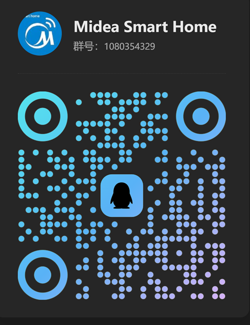

# Midea Smart Home

[![GitHub Release][releases-shield]][releases]
[![GitHub Activity][commits-shield]][commits]
[![License][license-shield]](LICENSE)
[![hacs][hacsbadge]][hacs]

Home Assistant 美的设备集成：本地局域网直连控制，同时支持美的云端 v2 / 云端 v1 兜底，并可读取云端用电、用水、用气统计。

## 获取帮助

- 欢迎加入QQ群交流，获取最新更新和帮助：



## 功能特点

- **三种接入方式自动探测**：添加设备时按 `cloud_v2 > 本地 > cloud_v1` 优先级自动选择可用通道，设备列表中用徽标标注实际接入方式
  - ☁️ **Cloud V2**：美居云端 Thing Model V2 属性查询与控制，适用于无法本地通信的新设备
  - 🖥️ **Lan**：局域网直连，状态由设备主动推送，控制指令直接下发，不依赖云端
  - ☁️ **Cloud V1**：美居云端 Lua 状态查询与控制，作为最后兜底
- **自动下载协议**：首次添加本地设备时自动从云端下载对应的 Lua 协议脚本
- **多筒洗衣机支持**：0xD9 复式洗衣机按筒位区分状态，左右双筒 / 上下双筒 / 三筒机型均可用（三筒机型由设备推送驱动）
- **云端统计传感器**：油烟机、空调、洗衣机、洗碗机、燃气热水器可读取云端统计（用电量 / 用水量 / 用气量 / 清洁度），独立于本地状态，默认每 6 小时刷新一次；复式洗衣机（已验证的多筒机型）按筒位分别统计；需要配置过美居账号，纯本地接入的设备不创建
- **可调轮询间隔**：本地设备轮询、云端设备查询间隔、0xD9 双筒轮询间隔均可在选项中按设备单独配置（三筒机型由推送驱动，无需轮询间隔）
- **更新提醒**：内置 update 实体，可配置关闭 / 12 小时 / 24 小时检查 GitHub Release，支持在 HA 内直接下载安装
- **在线状态通知**：可选择设备离线、恢复在线时是否发送通知
- **灵活扩展**：通过 `device_mapping` 目录下的映射文件自定义实体，方便适配新机型
- **待支持提示**：本地通信正常但缺少映射的设备会标记为"⏳ 待支持"，提示前往 GitHub 提交 Issue
- **多语言**：简体中文、English
- **实体平台**：binary_sensor、button、climate、cover、fan、humidifier、light、lock、number、select、sensor、switch、text、time、update、vacuum、water_heater

## 接入方式说明

| 接入方式 | 状态来源 | 控制方式 | 适用场景 |
| -------- | -------- | -------- | -------- |
| ☁️ Cloud V2 | 定时查询云端 Thing 属性 | 云端属性写入 | 设备不在同一局域网，或本地协议不兼容 |
| 🖥️ Lan | 设备主动推送 + 定时轮询 | 本地 TCP 直连 | 首选，响应最快且不依赖外网 |
| ☁️ Cloud V1 | 定时查询美居云端 Lua 状态 | 美居 Lua 控制接口 | 前两者均不可用时兜底 |

探测结果会记录在设备配置中，设备信息页的型号后会显示对应徽标；云端设备的查询间隔可在"配置轮询间隔时间"中单独调整。

## 工作流程

**配置阶段**

1. 用户输入美的账号密码
2. 登录美的云端 API，获取设备列表与设备详情（设备 ID、型号、SN8、品类等）

**发现阶段**

1. 按 `cloud_v2 > 本地 > cloud_v1` 顺序探测每种设备可用的接入方式
   - cloud_v2：账号下存在该设备、设备类型具备 Thing 属性映射，且云端属性查询有响应
   - 本地：局域网广播可发现设备，并能完成一次初始化查询
   - cloud_v1：以上均不可用时，尝试美居云端 Lua 状态查询
2. 本地通信正常但设备类型暂无映射的设备标记为"待支持"，不再尝试 cloud_v1
3. 自动下载本地设备对应的 Lua 协议文件
4. 获取本地设备的 Token 和 Key（仅 V3 协议设备需要，V1/V2 协议设备无需）

**运行阶段**

- **本地设备**：连接设备后由 Lua 脚本解析协议，普通设备通过设备推送回调更新状态；需要定时查询的设备（配置了 `polling_attributes`，以及 0xD9 双筒复式洗衣机）按各自间隔轮询，三筒复式洗衣机由推送驱动，控制指令直接下发到设备
- **云端设备**：按扫描间隔查询云端状态（cloud_v2 走 Thing 属性，cloud_v1 走美居 Lua），控制同样通过云端下发
- **云端统计**：与设备状态解耦，独立按 6 小时间隔拉取一次
- 设备离线/恢复在线时，可按设置发送通知

## 云端统计传感器

云端统计不受接入方式影响，只要集成里配置过美居账号，LAN 与云端设备都会创建。不同设备类型提供的指标如下：

| 设备类型 | 设备 | 统计指标 | 单位 |
| -------- | ---- | -------- | ---- |
| 0xB6 | 油烟机 | 风机清洁度、油盒清洁度、滤网清洁度 | % |
| 0xAC | 空调 | 昨日用电量、月度用电量、年度用电量 | kWh |
| 0xD9 | 复式洗衣机（已验证多筒机型） | 每个筒位单独的今日 / 本周 / 月度 用电量、用水量 | kWh、L |
| 0xDB | 滚筒洗衣机 | 今日 / 本周 / 月度 用电量、用水量 | kWh、L |
| 0xE1 | 洗碗机 | 今日 / 本周 / 月度 / 年度 用水量、用电量 | L、kWh |
| 0xE3 | 燃气热水器 | 今日 / 月度 用水量、用气量 | L、m³ |

> 统计值来自美的云端，部分指标（例如空调当日用电量）需要等云端结算后才会有数据；空调因此展示"昨日用电量"。
> 油烟机仅开放清洁度类统计，云端暂未提供用电量接口。
> 复式洗衣机仅已验证支持云统计的多筒机型（三筒 13363、双筒 13368）提供统计，实体名带 `_l` / `_r`（三筒另有 `_b`）后缀区分左筒、右筒、下筒；其他机型号不创建。

## 环境要求

- **Home Assistant** >= 2025.12.4

## 安装

### 一键安装（推荐）

[](https://my.home-assistant.io/redirect/hacs_repository/?owner=Cyborg2017&repository=midea_smart_home&category=integration)

### HACS 自定义仓库

1. 在 Home Assistant 中打开 HACS
2. 进入"集成"
3. 点击右上角"+"按钮
4. 点击"⚙️ 自定义存储库"（3 点菜单 > 自定义存储库）
5. 输入：`https://github.com/Cyborg2017/midea_smart_home`
6. 类别选择：**集成**
7. 点击"添加"
8. 搜索"Midea Smart Home"并点击"下载"

### 手动安装

1. 将 `custom_components/midea_smart_home` 目录复制到您的 Home Assistant `custom_components` 文件夹
2. 重启 Home Assistant
3. 进入 设置 > 设备与服务
4. 点击"添加集成"
5. 搜索"Midea Smart Home"

## 集成选项

进入 设置 > 设备与服务 > Midea Smart Home > 配置，可执行：

| 选项 | 说明 |
| ---- | ---- |
| 添加设备（本地 / 自动 / 手动） | 本地方式仅扫描局域网；自动方式登录账号后按优先级探测；手动方式不联网，直接填写设备信息 |
| 更新账号 | 修改美的账号密码并重新拉取设备列表 |
| 同步云端 | 从云端刷新设备信息（名称、房间、型号等） |
| 备份配置 | 备份集成配置与设备映射 |
| 获取诊断 | 导出诊断信息，便于排查问题或提交 Issue |
| 清除缓存 | 清除 Lua 脚本与 JSON 缓存，重新从云端下载 |
| 配置轮询间隔时间 | 按设备设置本地轮询间隔（关闭 / 1s\~30s）、云端查询间隔（3s\~30s）、0xD9 双筒轮询间隔（1s\~5s） |
| 配置通知 | 设置设备离线、恢复在线是否发送通知 |
| 配置更新检查 | 关闭 / 12 小时 / 24 小时检查 GitHub Release |

## 文档

- 📖 **[配置指南](docs/guides/SETUP_GUIDE.md)**：集成安装、添加设备、选项功能与常见问题的图文教程
- 🤖 **[借助 AI 适配 / 调试设备指南](docs/guides/AI_DEVICE_GUIDE.md)**：想让列表中"⏳ 待支持"的新设备尽快可用，或设备实体缺失、数值异常、Lua 协议解析有问题时，按本指南收集诊断材料并配合 AI 编程助手（Trae、ChatGPT、Claude、Cursor 等）完成适配与调试，内含数据链路说明、`device_mapping` 配置速查、CI 格式规则和可直接复制的提示词模板

## 支持的设备

| 序号 | 代码   | 设备类型          |
| ---- | ------ | ----------------- |
| 1  | 0x13 | 智能灯 / 风扇灯 / 鱼缸灯  |
| 2  | 0x14 | 电动窗帘         |
| 3  | 0x17 | 晾衣架           |
| 4  | 0x26 | 浴霸            |
| 5  | 0x40 | 凉霸            |
| 6  | 0x58 | 智能鱼缸（仅云端接入） |
| 7  | 0x9B | 烤箱            |
| 8  | 0x9C | 集成灶           |
| 9  | 0xA1 | 除湿机           |
| 10 | 0xAC | 柜式空调 / 壁挂空调 / 中央空调 & 风管机 / 新风 / 迷你新风 |
| 11 | 0xAD | 空气魔方（检测仪） |
| 12 | 0xB0 | 微波炉           |
| 13 | 0xB3 | 消毒柜           |
| 14 | 0xB6 | 油烟机           |
| 15 | 0xB8 | 扫地机器人         |
| 16 | 0xBC | 空气检测仪（温度 / 湿度 / CO₂ / PM2.5 / PM10） |
| 17 | 0xBF | 微蒸烤一体机         |
| 18 | 0xC2 | 智能马桶         |
| 19 | 0xCA | 多开门冰箱         |
| 20 | 0xCC | Wifi线控器 (中央空调 / 风管机)         |
| 21 | 0xCD | 空气能热水器         |
| 22 | 0xCE | 新风            |
| 23 | 0xCF | 中央空调(水力)     |
| 24 | 0xD9 | 复式洗衣机 (左右双筒 / 上下双筒 / 三筒)        |
| 25 | 0xDA | 波轮洗衣机         |
| 26 | 0xDB | 滚筒洗衣机         |
| 27 | 0xDC | 干衣机           |
| 28 | 0xE1 | 洗碗机           |
| 29 | 0xE2 | 电热水器          |
| 30 | 0xE3 | 燃气热水器         |
| 31 | 0xE6 | 壁挂炉           |
| 32 | 0xEA | 电饭煲         |
| 33 | 0xEC | 电压力锅         |
| 34 | 0xED | 净饮机 / 净水机 / 管线机 / 软水机 / 前置过滤器 |
| 35 | 0xF1 | 破壁机         |
| 36 | 0xFA | 风扇            |
| 37 | 0xFB | 取暖器           |
| 38 | 0xFC | 空气净化器         |
| 39 | 0xFD | 加湿器           |

> 0x58 智能鱼缸走 Cloud V2 云端属性，不支持本地 TCP 控制，需要在含云端的接入模式下添加。

> 其他类型的设备正在适配中，欢迎贡献代码！

## 日志与排查

日志统一带模块前缀（如 `[cloud]`、`[device]`、`[coord]`），设备相关日志会带上设备名称（如 `[双筒洗衣机]`），便于过滤。排查问题时在 `configuration.yaml` 中开启调试日志：

```yaml
logger:
  default: warning
  logs:
    custom_components.midea_smart_home: debug
```

如需反馈问题，请附上"获取诊断"导出的文件与对应时间段日志。

## 致谢

本项目参考/使用了以下项目的部分代码：

- [midea_auto_cloud](https://github.com/sususweet/midea_auto_cloud)
- [midea_ac_lan](https://github.com/wuwentao/midea_ac_lan)
- [midea-local](https://github.com/midea-lan/midea-local)

[commits-shield]: https://img.shields.io/github/commit-activity/y/Cyborg2017/midea_smart_home.svg?style=for-the-badge
[commits]: https://github.com/Cyborg2017/midea_smart_home/commits/main
[hacs]: https://github.com/hacs/integration
[hacsbadge]: https://img.shields.io/badge/HACS-Custom-orange.svg?style=for-the-badge
[license-shield]: https://img.shields.io/github/license/Cyborg2017/midea_smart_home.svg?style=for-the-badge
[releases-shield]: https://img.shields.io/github/release/Cyborg2017/midea_smart_home.svg?style=for-the-badge
[releases]: https://github.com/Cyborg2017/midea_smart_home/releases
