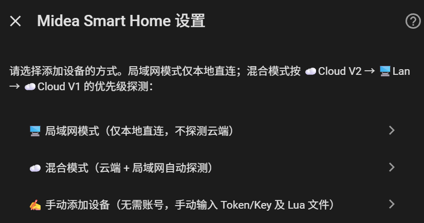
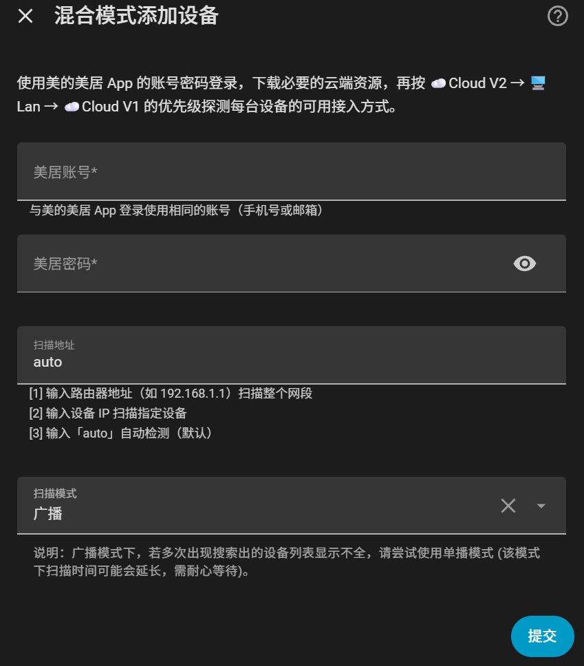
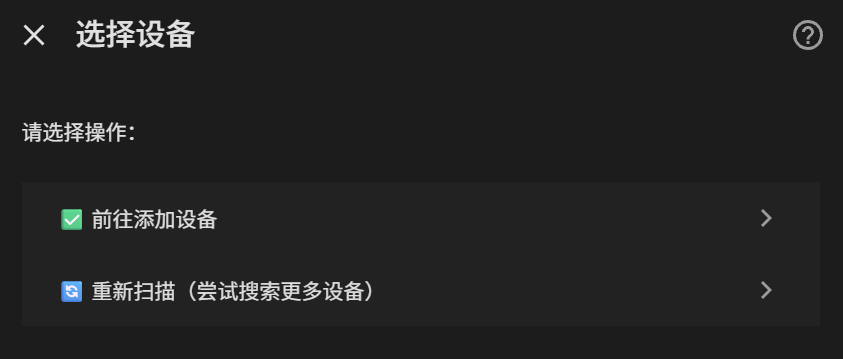
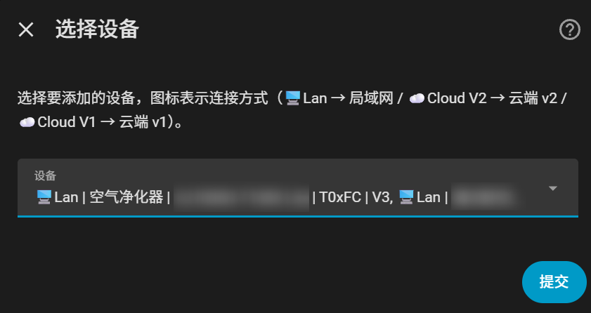
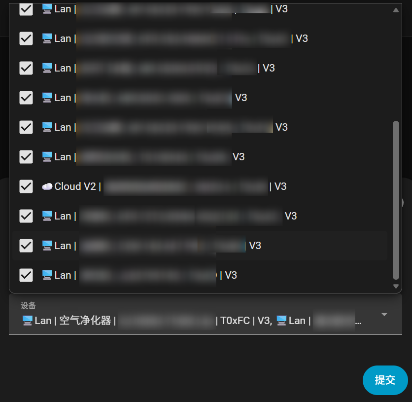
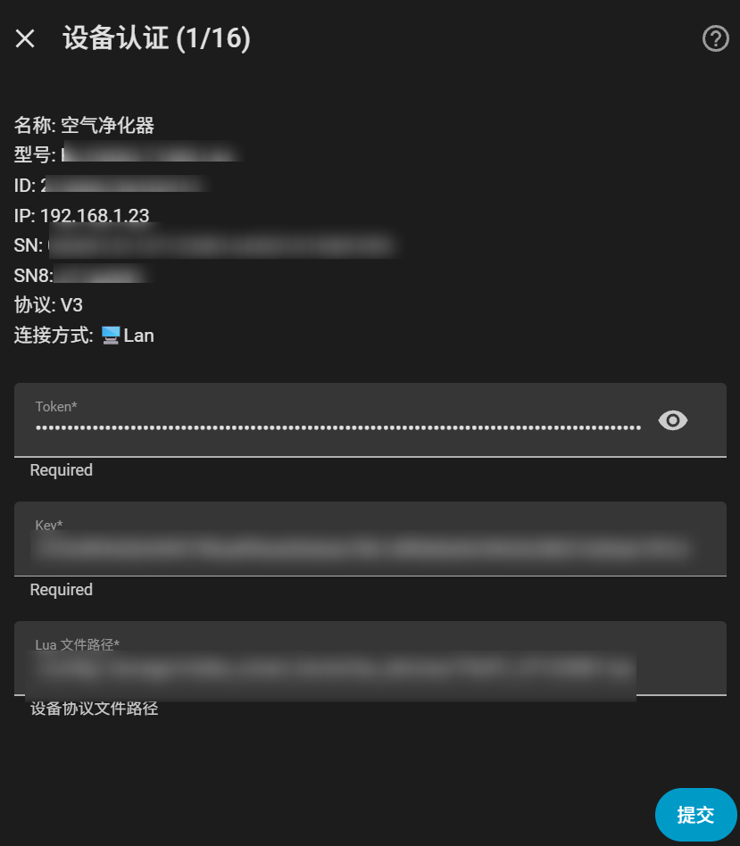
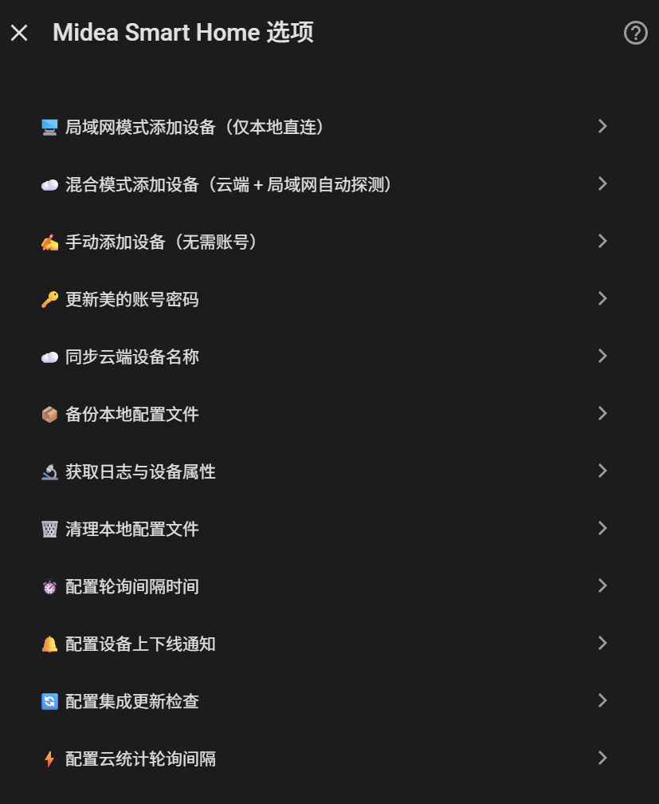

# Midea Smart Home 配置指南

本指南帮助您完成 Midea Smart Home 集成的安装与配置。

## 目录

- [前置条件](#前置条件)
- [安装集成](#安装集成)
- [添加设备](#添加设备)
- [选项功能](#选项功能)
- [常见问题](#常见问题)

---

## 前置条件

1. 已注册的美的美居账号（手机号或邮箱）
2. 设备已在美的美居 App 中绑定
3. Home Assistant 与设备在同一局域网

## 安装集成

**HACS 安装（推荐）**

1. HACS → 集成 → 搜索 "Midea Smart Home"
2. 点击下载并重启 Home Assistant

**手动安装**

将 `custom_components/midea_smart_home` 复制到 Home Assistant 的 `custom_components` 目录，然后重启。

---

## 添加设备

进入 **设置 → 设备与服务 → 添加集成**，搜索 "Midea Smart Home"。

### 1. 选择添加方式



| 方式 | 说明 |
| ---- | ---- |
| 局域网模式 | 仅本地直连，不探测云端 |
| 混合模式 | 云端 + 局域网自动探测，按 `Cloud V2 → Lan → Cloud V1` 优先级选择接入方式 |
| 手动添加设备 | 无需账号，手动填写 Token / Key 及 Lua 文件 |

### 2. 填写账号（混合模式）



- **美居账号 / 密码**：与美的美居 App 登录使用的账号一致
- **扫描地址**：`auto` 自动检测（默认）；填路由器地址扫描整个网段；填设备 IP 只扫描该设备
- **扫描模式**：广播（默认）；搜到的设备不全时改用单播，耗时会长一些

### 3. 选择设备



- **前往添加设备**：进入设备列表勾选要添加的设备
- **重新扫描**：重新搜索局域网设备（不会重新登录云端）





设备图标表示接入方式（🖥 Lan / ☁ Cloud V2 / ☁ Cloud V1）。列表默认全部勾选，取消不需要的设备后点击**提交**。

### 4. 设备认证



集成会自动获取设备的 Token / Key（V3 协议需要，V1/V2 无需）以及 Lua 协议文件。此步骤需要访问云端，请保持网络畅通。

### 5. 配置完成

提交后集成条目出现在 **设置 → 设备与服务**，设备实体自动生成。

---

## 选项功能

点击集成条目上的**配置**进入选项菜单：



| 选项 | 说明 |
| ---- | ---- |
| 局域网模式 / 混合模式 / 手动添加设备 | 追加新设备 |
| 更新美的账号密码 | 密码变更后在此更新 |
| 同步云端设备名称 | 从云端刷新设备名称、型号等信息，完成后自动重载 |
| 备份本地配置文件 | 备份集成配置与设备映射 |
| 获取日志与设备属性 | 导出诊断信息，便于排查或提交 Issue |
| 清理本地配置文件 | 清除 Lua / JSON 缓存并重新下载（旧文件备份到 `.storage/midea_smart_home-backup`） |
| 配置轮询间隔时间 | 按设备设置本地轮询、云端查询、0xD9 双筒轮询间隔 |
| 配置设备上下线通知 | 设置设备离线 / 恢复在线时是否发送通知 |
| 配置集成更新检查 | 关闭 / 12 小时 / 24 小时检查新版本 |
| 配置云统计轮询间隔 | 设置云端用电、用水等统计的刷新间隔 |

---

## 常见问题

### Q: 扫描不到设备？

1. 确认设备已通电并绑定在美的美居 App
2. 确认 Home Assistant 与设备处于同一网段
3. 尝试把扫描地址改为路由器地址（如 `192.168.1.1`），或直接填设备 IP
4. 尝试切换到单播模式重新扫描

### Q: 认证时 Token / Key 为空？

确认能访问 `mapp.appsmb.com`，网络正常后重试；仍失败请附日志提交 Issue。

### Q: 提示 v2 协议不支持？

日志出现 `This format is recognized but TCP communication is not yet supported` 时，表示该设备暂不支持本地通信，可尝试混合模式走云端接入。

### Q: 支持哪些设备？

见 [支持的设备列表](../../README.md#支持的设备)。

---

## 调试日志

在 `configuration.yaml` 中添加：

```yaml
logger:
  default: warning
  logs:
    custom_components.midea_smart_home: debug
```

重启后可在 **设置 → 系统 → 日志** 查看。提交 Issue 时请附日志并移除 Token、Key、账号等敏感信息。

## 技术支持

问题反馈：[GitHub Issues](https://github.com/Cyborg2017/midea_smart_home/issues)
